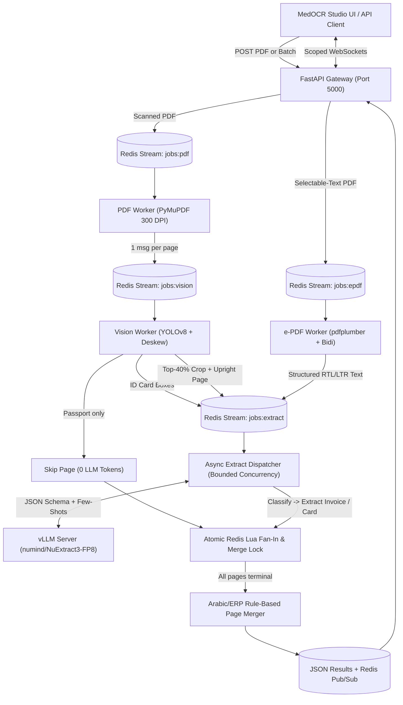

# MedicalOCRv2 — MedOCR Studio

> **Event-driven Arabic & English medical claim extraction platform** combining custom YOLO vision triage, `pdfplumber` + `python-bidi` electronic PDF parsing, constrained `NuExtract3-FP8` VLM inference on `vLLM`, and rule-based multi-page claim assembly over Redis Streams.

---

## Overview

**MedicalOCRv2** (`Document Batch Processor v3.0.0`) converts multi-page hospital claim packets—containing inpatient bills, outpatient receipts, insurance ID cards, prescriptions, discharge sheets, and passports—into clean, validated, merged JSON records ready for downstream claims adjudication.

Rather than running a monolithic API that blocks on GPU inference, the system decouples ingestion, computer-vision preprocessing, electronic text table parsing, bounded-concurrency VLM extraction, and deterministic multi-page merging across independent **Redis Streams** worker groups with real-time **WebSocket** progress streaming.

---

## System Architecture



---

## Key Engineering Highlights

### 1. Dual-Track Processing Pipelines
* **Scanned Image OCR Track (`/process-pdf/`, `/batch-process-pdf/`)**:
  1. **PDF Rendering**: Renders validated PDFs to `300 DPI` page images via PyMuPDF and immediately fans out per-page tasks.
  2. **YOLO Vision Triage**: Runs two custom Ultralytics YOLO models (`id_card_detection` and `orientation_classifier`) to drop passport-only pages early, crop and upright multiple insurance ID cards per page, rotate sideways/upside-down claim pages (`90°`/`180°`/`270°`), and deskew tilted scans via Otsu binarization + projection-profile variance maximization.
  3. **Two-Step VLM Routing**: Classifies pages cheaply using a `150 DPI` top-40% header crop packed with visual few-shot examples, then routes only true invoice pages (at `250 DPI`) or ID card crops to schema-specific extraction stages.
* **Electronic PDF Fast-Path (`/api/epdf/process`, `/api/epdf/batch`)**:
  * Verifies embedded selectable text upfront (returning `HTTP 422` for image-only scans) and bypasses rendering, YOLO, and page classification altogether.
  * Extracts vector tables via `pdfplumber`, restores logical Arabic reading order with `python-bidi` while preserving embedded LTR Latin runs, repairs ERP font-ligature artifacts, unpacks borderless merged cells, and sends compact pipe-delimited tables directly to NuExtract in text mode.

### 2. Constrained VLM Inference & Exact Vision Token Budgeting
* **Grammar-Enforced Outputs**: Compiles shorthand provider templates into strict JSON Schemas (`additionalProperties: false`, typed arrays, enums) enforced at token generation time by `vLLM` + `xgrammar`.
* **Inline Field-Note Prompting**: Template fields can embed localized extraction hints right beside types (e.g., `"verbatim-string. Copy digits after إيصال رقم."`); the client automatically strips prose for JSON Schema compilation and hoists notes into NuExtract's `instructions` prompt.
* **Qwen2-VL Patch-Grid Token Math**: Computes exact vision token budgets (`patch_size=16`, `merge_size=2`, `32,768` context cap) across packed visual few-shot examples, prompt schemas, and `max_tokens`, dynamically downscaling oversized images while enforcing a minimum long-edge guard (`1600 px`) so over-shrunk invoices fail explicitly instead of hallucinating numbers.

### 3. Domain-Aware Post-OCR Self-Healing & Merging
* **"Sandwiched Page" ID Repair**: Automatically heals single-page OCR header misreads when page `N-1` and `N+1` are consecutive and share matching claim/patient identifiers.
* **Boundary-Only Fuzzy Arabic Section Merging**: Normalizes Arabic letter variants (`أ/إ/آ/ٱ → ا`, `ة → ه`, `ى → ي`), harakat/tatweel, and Arabic-Indic digits, applying fuzzy title matching (`≥ 85%`) strictly across page breaks so distinct sections on the same page stay separate.
* **Algebraic & ERP Rule Repairs**: Detects unit-price vs. net-price column swaps using `quantity × unit_price ≈ patient_share + payer_share`, separates inpatient vs. outpatient receipts, routes provider-specific pharmacy codes into dedicated medicine sections, and recomputes section subtotals.

### 4. Distributed Reliability & Real-Time Streaming
* **Atomic Fan-In State**: Custom Redis Lua scripts (`HSETNX` + `DECR` page completion, multi-crop aggregation, batch counters, and token-verified `merge_lock`) guarantee exactly-once document assembly under concurrent worker completions and stream redeliveries.
* **Self-Healing Consumers**: Workers reclaim stalled messages via `XAUTOCLAIM` with in-flight deduplication and cap poison-pill retries via `MAX_DELIVERIES`.
* **Scoped Real-Time WebSockets**: Streams live per-page and batch events with immediate snapshot replay for late-joining clients, backed by disk fallback after Redis TTL expiration.

---

## Supported Provider Templates

Templates live in [`app/templates/`](app/templates/) alongside curated few-shot manifests for classification, invoices, and insurance ID cards:

| Template Key | Provider | Supported Document Schemas | Pipeline Support |
| :--- | :--- | :--- | :--- |
| `janzour` | Janzour Clinic (`عيادة جنزور`) | `invoice`, `id_card`, `medicine_details`, `discharge_sheet` | Scanned OCR + Electronic PDF (`epdf`) |
| `safwa` | Safwa International Hospital (`مستشفى الصفوة الدولي`) | `inpatient_invoice`, `outpatient_invoice`, `id_card` | Scanned OCR |
| `massara` | Massara Clinic (`مصحة المسرة`) | `inpatient_invoice`, `outpatient_invoice`, `id_card` | Scanned OCR |
| `musafat` | Al Muasafat Clinic (`مصحة المواصفات`) | `inpatient_invoice`, `outpatient_invoice`, `id_card` | Scanned OCR |

---

## Repository Structure

```text
.
├── app/
│   ├── api/                    # FastAPI routes (PDF, e-PDF, health, auth) & upload validation
│   ├── core/
│   │   ├── document/           # PyMuPDF 300 DPI page rendering
│   │   ├── epdf/               # Electronic PDF text-layer validator & provider table parsers
│   │   ├── extract/            # vLLM NuExtract client, Qwen2-VL token budget, few-shot loader
│   │   ├── jobs/               # Redis Streams consumer loop & atomic Lua state scripts
│   │   ├── merge/              # Arabic/ERP multi-page invoice merger & final payload assembler
│   │   ├── vision/             # YOLO ID-card/passport detection, orientation, and deskewing
│   │   ├── notifications.py    # Redis Pub/Sub helpers for task and batch channels
│   │   └── security.py         # API Key & HS256 JWT auth for HTTP and WebSockets
│   ├── models/                 # Pydantic request/response schemas
│   ├── services/               # Standalone worker entrypoints (pdf, epdf, vision, extract, cleanup)
│   ├── templates/              # Provider extraction templates & allow-list (index.json)
│   ├── classifier_examples/    # Per-provider top-crop few-shot examples
│   ├── invoice_examples/       # Per-provider inpatient/outpatient few-shot examples
│   ├── id_card_examples/       # Per-provider insurance card few-shot examples
│   ├── config.py               # Environment-driven Pydantic settings
│   └── main.py                 # Lightweight FastAPI application entrypoint
├── deploy/
│   ├── docker/                 # Dockerfiles for API, Vision worker, vLLM, and Frontend
│   ├── k8s/                    # Kubernetes deployments, PVCs, ConfigMaps, and CronJobs
│   └── vllm/                   # Checkpoint preflight verifier & host vLLM launch scripts
├── frontend/                   # MedOCR Studio (React + Vite UI & HTTP/WS reverse-proxy server)
├── tests/                      # Fast unit tests for token budgets, merging, e-PDF parsing & API
├── requirements-api.txt        # API, PDF/e-PDF, and extract-dispatcher dependencies
└── requirements-vision.txt     # Vision worker dependencies (OpenCV, Ultralytics YOLO)
```

---

## API Reference

All protected endpoints accept either an `X-API-Key: <API_KEY>` header or an `Authorization: Bearer <JWT>` token (obtainable via `POST /api/auth/token`).

| Method | Endpoint | Description |
| :--- | :--- | :--- |
| `POST` | `/api/auth/token` | Exchange a valid API Key for a signed HS256 Bearer JWT |
| `POST` | `/process-pdf/` | Upload and queue a single scanned PDF (`template`, `file`) |
| `POST` | `/batch-process-pdf/` | Upload and queue up to `MAX_BATCH_FILES` scanned PDFs |
| `GET` | `/api/epdf/templates` | List provider templates with registered e-PDF parsers |
| `POST` | `/api/epdf/process` | Validate embedded text layer and queue a single electronic PDF |
| `POST` | `/api/epdf/batch` | Validate and queue a batch of electronic PDFs |
| `GET` | `/api/jobs/{task_id}` | Poll job progress, page counts, and merged JSON result |
| `GET` | `/api/batches/{batch_id}` | Poll aggregated batch progress and child job results |
| `WS` | `/ws/{task_id}` | Real-time WebSocket stream scoped to a single job |
| `WS` | `/ws/batch/{batch_id}` | Real-time WebSocket stream scoped to a batch |
| `GET` | `/api/health/` | Liveness/readiness check (Redis connectivity & loaded templates) |
| `GET` | `/api/health/templates` | Validate and list all active extraction templates |

### Quick Example

```bash
# 1. Submit a scanned claim packet
curl -X POST "http://localhost:5000/process-pdf/" \
  -H "X-API-Key: <YOUR_API_KEY>" \
  -F "template=janzour" \
  -F "file=@claim_packet.pdf"

# 2. Fetch job status and merged invoices/ID cards
curl -H "X-API-Key: <YOUR_API_KEY>" \
  "http://localhost:5000/api/jobs/<TASK_ID>?include_raw_pages=false"
```

---

## Local Setup & Running Workers

### Prerequisites
* **Python 3.11+** (and **Node.js 20+** for the MedOCR Studio frontend)
* **Redis 7+** (`redis://localhost:6379/0`)
* **vLLM** serving `numind/NuExtract3-FP8` with `--max-model-len 32768 --limit-mm-per-prompt '{"image": 8, "video": 0}'`
* YOLO weights placed at `models/id_card_detection/best.pt` and `models/orientation_classifier/best.pt`

### 1. Install Dependencies

```bash
python -m venv .venv
source .venv/bin/activate
pip install -r requirements-api.txt -r requirements-vision.txt
```

### 2. Configure Environment (`.env`)

```env
REDIS_URL=redis://localhost:6379/0
VLLM_API_URL=http://127.0.0.1:8000/v1
VLLM_MODEL_NAME=numind/NuExtract3-FP8
VLLM_MAX_MODEL_LEN=32768

AUTH_ENABLED=true
API_KEY=<replace-with-strong-api-key>
JWT_SECRET_KEY=<replace-with-strong-jwt-secret>
CORS_ORIGINS=["http://localhost:3000"]
```

### 3. Start Services

Run each component in its own process (or deploy via [`deploy/k8s/`](deploy/k8s/)):

```bash
# FastAPI Gateway
uvicorn app.main:app --host 0.0.0.0 --port 5000

# Background Stream Workers
python -m app.services.pdf_worker
python -m app.services.epdf_worker
python -m app.services.vision_worker
python -m app.services.extract_worker

# MedOCR Studio Frontend (Port 3000)
cd frontend && npm install && npm run build && node server.mjs
```

---

## Testing

The test suite validates template schemas, Qwen2-VL context-window token budgets, Arabic/ERP multi-page merge edge cases, e-PDF RTL/LTR table parsing, upload guards, and API/WebSocket auth without requiring a live GPU or Redis server:

```bash
python -m unittest discover -s tests -v
```
